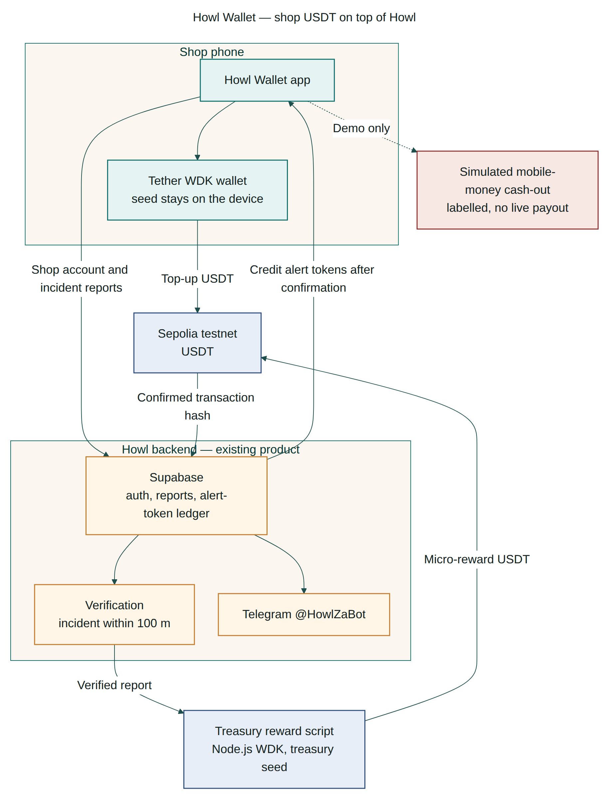
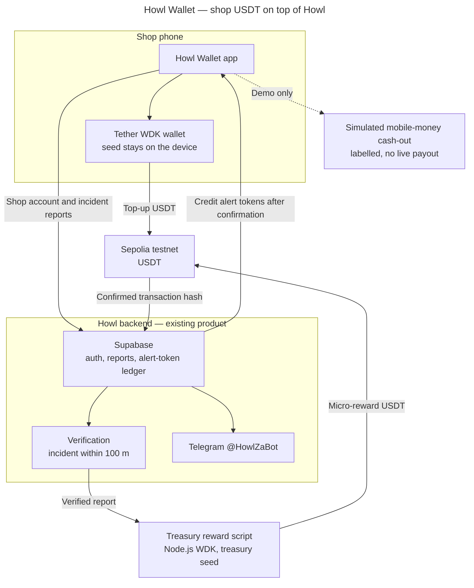
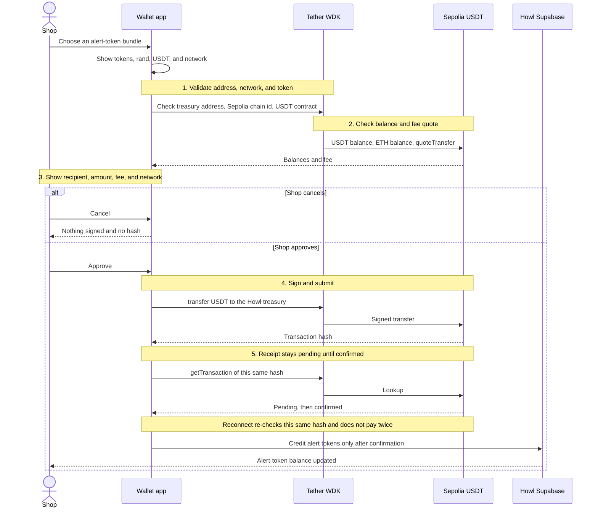
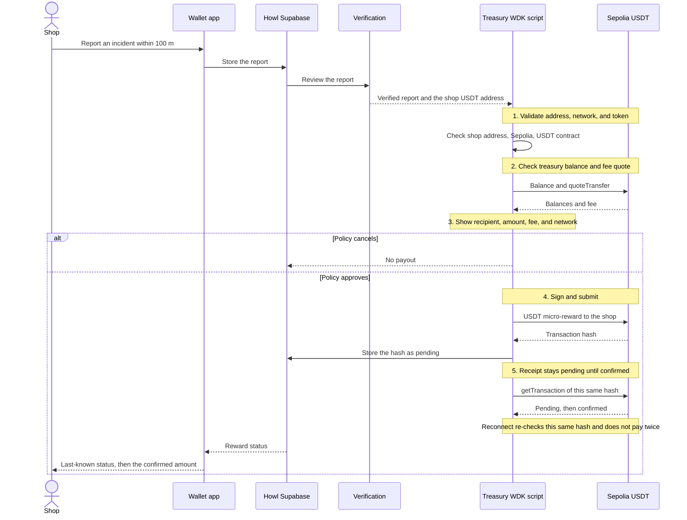

# Howl Wallet architecture

Howl Wallet is a payments add-on for [Howl](https://howlza.co.za). Howl already warns Cape Town shops about unrest. This repo adds a self-custodial USDT wallet, token top-ups, and verified-report rewards. Howl's Supabase app, Vercel site, Telegram bot, Resend mail, PostHog, and SnapScan checkout stay in Howl's private repo. They are not implemented here.

The chain in this checkpoint is Ethereum Sepolia. The working signer is `scripts/wallet.ts` (`@tetherto/wdk` and `@tetherto/wdk-wallet-evm`). The Expo app is the shop-facing shell. On-device signing through the [Tether WDK React Native starter](https://github.com/tetherto/wdk-starter-react-native) is not wired yet.

## Diagram

`docs/architecture.mmd` is the file rendered to `docs/architecture.png`. Regenerate it with `@mermaid-js/mermaid-cli`, using `docs/mermaid.theme.json` and a local Chrome path in `docs/puppeteer.json`.

## Pieces

| Piece | Where it lives | Role |
| --- | --- | --- |
| Shop phone | `app/` | Shows the bundle, the rand and USDT amounts, the fee, and the network. Approve and cancel live here. The recovery phrase is never shown. |
| WDK wallet | `scripts/wallet.ts` today; on-device worklet later | Derives the shop address, quotes a USDT transfer, signs it, and reads the receipt. |
| Howl backend | Existing Supabase project, not this repo | Shop login, incident reports, verification, and the alert-token ledger. |
| Telegram `@HowlZaBot` | Existing Howl bot | Sends the alerts a shop spends tokens on. |
| Treasury reward script | Same CLI, opened with the treasury seed | Pays a small USDT reward after Howl marks a report verified. |
| Sepolia USDT | Chain id 11155111 | Testnet only. Default contract `0x7169D38820dfd117C3FA1f22a697dBA58d90BA06` (Test Tether USD). |
| Mobile-money cash-out | `app/` cash-out tab | Simulated and labelled. No provider is called and no USDT moves. |

A shop report is only eligible when it is made within 100 metres of the incident. That rule stays in Howl's verification step. This repo does not reimplement it.

Alert-token prices are the ones Howl already sells: R20 = 10, R40 = 20, R80 = 50, R150 = 100, R300 = 220. The USDT amount is `rand / ZAR_PER_USDT`, rounded up to the next base unit (6 decimals). The checkpoint rate is the Frankfurter snapshot from 11 Nov 2026, 16.5639 rand per US dollar, with 1 USDT treated as 1 USD. It is not a live quote.

## Tether payment steps

Every USDT movement in this design follows Tether's payment flow:

1. Validate the address, the network, and the token.
2. Check the balance and quote the fee.
3. Show the recipient, the amount, the fee, and the network. The person or policy approves or cancels.
4. Sign and submit.
5. Read the receipt. Stay pending until the transfer is confirmed.

Reconnect is part of step 5. The app or the script keeps the transaction hash. When the signal returns, it calls `getTransaction` on that same hash. It does not build a second transfer for the same top-up or the same reward. Alert tokens are credited only when finality is `confirmed` or `final` and `success` is true. A reverted or dropped hash does not credit tokens.

`scripts/wallet.ts` implements that flow on Sepolia. `quote` stops after step 3. `send` signs only with `--approve` or the word `approve` typed at a terminal. With no choice, it cancels. `status --hash` is the re-check.

## (a) USDT token top-up

The shop picks a bundle in the app. The app shows the token count, the rand price, the USDT amount, and the network. The wallet script then runs the five steps against the Howl treasury address. Howl's Supabase ledger credits alert tokens only after the receipt is confirmed. This repo does not write that ledger.

If the phone drops offline after submit, the last screen keeps the hash and the last finality it saw. On reconnect the app asks WDK for that hash again. A missing receipt means "not seen yet", not "send it again".

## (b) Verified-report reward

The shop files an incident in Howl, inside the 100 metre rule. Howl verifies it. The treasury script, using the treasury seed, pays the shop's USDT address. The shop wallet does not sign this transfer. The treasury does. The same five steps apply, and the same hash is re-checked after a dropped connection.

There is no separate long-running reward server in this checkpoint. The treasury path is `scripts/wallet.ts send` opened with the treasury seed. A service that listens for verified reports and calls that flow is still to build. Until it exists, nothing in this repo pays a reward on its own.

## Cash-out

Cash-out to mobile money is a labelled simulation in the app. It does not quote a fee, sign a transaction, or call a mobile-money API. A later version would run the same five-step USDT transfer to a payout partner, then mark the mobile-money leg as paid only after that hash confirms.

## Next

The next product step is an unrest relief pool. Member shops would deposit USDT into a shared pool and receive an automatic payout when Howl verifies an incident near them. That pool should use the same validate, quote, approve, submit, and re-check flow, with the pool wallet as the payer.
