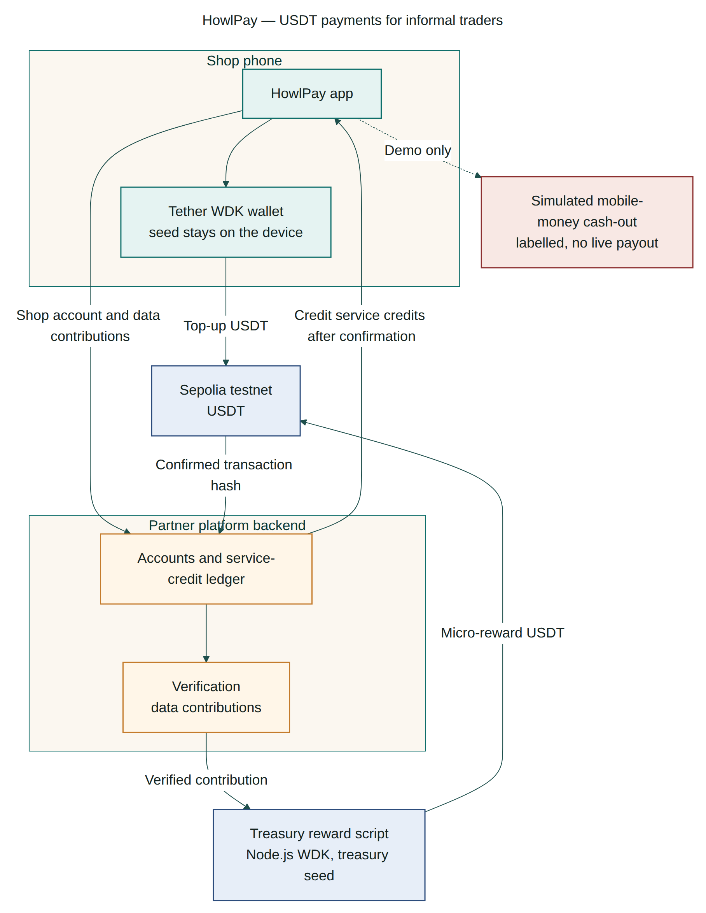

---
tags:
  - build
  - architecture
status: active
date: 2026-11-12
---

# Architecture

Source of truth: [docs/architecture.md](../../docs/architecture.md).

Shop phone (HowlPay plus Tether WDK) pays Sepolia USDT to a platform treasury for service credits. The partner verifies a data contribution and the treasury script pays the shop. The same transaction hash is re-checked after a dropped signal. Cash-out is a labelled simulation.

Live Sepolia addresses, balances, and the confirmed R20 top-up are in [[Testnet]]. Sequences for top-up and reward, including approve/cancel and the re-check, are in the architecture doc. Product steps: [[User Flows]].

The phone UI is still a shell. Signing today is `scripts/wallet.ts`. Wiring live balance, approve, pending/confirmed, and reconnect into the Expo app is the next build step ([[Tasks]]).
